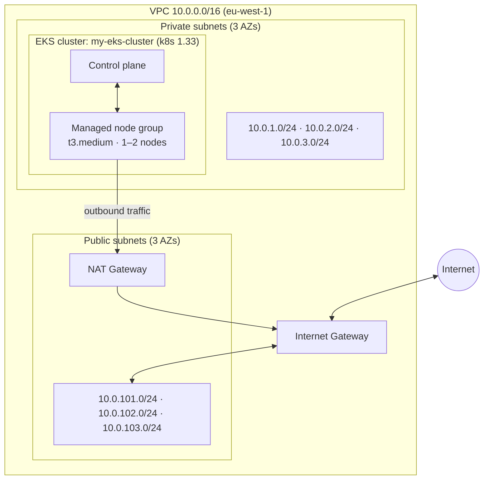

# AWS VPC + EKS with Terraform (tested locally on Floci)

Infrastructure as Code that provisions a production-style **AWS network and Kubernetes cluster**: a 3-AZ VPC with public/private subnets and a NAT gateway, and an **Amazon EKS** cluster with a managed node group running in the private subnets.

The whole stack is developed and tested **at zero AWS cost** against [Floci](https://github.com/floci-io/floci), an open-source local AWS emulator that runs EKS as a real k3s Kubernetes cluster in Docker.


---

## Architecture



## What it creates

| Area | Resources |
|------|-----------|
| **Networking** | VPC, 3 public + 3 private subnets across 3 AZs, Internet Gateway, NAT Gateway, route tables |
| **Kubernetes** | EKS control plane (v1.33), managed node group (t3.medium, autoscaling 1–2) |
| **Security** | Cluster and node security groups, an application security group (HTTP in, all out), KMS key for Kubernetes secrets encryption |
| **IAM** | Cluster role, node role, and policy attachments created by the EKS module |
| **Logging** | CloudWatch log group for the EKS control plane |

About 65 AWS resources in total, built with the official community modules
[`terraform-aws-modules/vpc`](https://registry.terraform.io/modules/terraform-aws-modules/vpc/aws) and
[`terraform-aws-modules/eks`](https://registry.terraform.io/modules/terraform-aws-modules/eks/aws).

## Project structure

```
.
├── provider.tf          # AWS provider, pointed at Floci (localhost:4566)
├── vpc_module.tf        # VPC, subnets, NAT gateway
├── eks_cluster.tf       # EKS cluster + managed node group
├── security_groups.tf   # Application security group and rules
├── variables.tf         # Region, VPC CIDR, Kubernetes version
└── output.tf            # Cluster name, endpoint, security group, region
```

## Design decisions

- **Nodes in private subnets only.** Worker nodes have no public IPs. Outbound traffic (image pulls, updates) goes through the NAT gateway.
- **A single NAT gateway** keeps dev costs down. For production high availability, set `single_nat_gateway = false` to get one NAT per AZ.
- **Wiring between modules.** The EKS module takes `vpc_id` and `subnet_ids` straight from the VPC module's outputs, so nothing is hardcoded and Terraform works out the creation order.
- **Secrets encryption** with a KMS key, created by the EKS module.
- **Local-first testing.** Floci emulates AWS APIs, so the full `plan → apply → kubectl → destroy` cycle runs in minutes with no cloud bill.

## Run it locally (Floci)

### Prerequisites
- [Docker Desktop](https://www.docker.com/products/docker-desktop/)
- [Terraform](https://developer.hashicorp.com/terraform/install) ≥ 1.5
- [AWS CLI v2](https://aws.amazon.com/cli/) and [kubectl](https://kubernetes.io/docs/tasks/tools/)

### 1. Start Floci
Floci needs the Docker socket so it can start the k3s container that serves as the EKS cluster.

```bash
docker run -d --name floci -p 4566:4566 -u root \
  -v /var/run/docker.sock:/var/run/docker.sock \
  floci/floci:latest
```

### 2. Deploy
```bash
terraform init
terraform plan
terraform apply -auto-approve
```

### 3. Connect kubectl
```bash
docker cp "floci-aws-eks-eu-west-1.my-eks-cluster:/etc/rancher/k3s/k3s.yaml" kubeconfig.yaml
sed -i 's/127.0.0.1:6443/127.0.0.1:6500/' kubeconfig.yaml
export KUBECONFIG=$PWD/kubeconfig.yaml

kubectl get nodes
kubectl get pods -A
```

### 4. Verify the AWS resources
```bash
export AWS_ACCESS_KEY_ID=test AWS_SECRET_ACCESS_KEY=test AWS_DEFAULT_REGION=eu-west-1
EP=--endpoint-url=http://localhost:4566

aws ec2 describe-vpcs $EP --output table
aws ec2 describe-subnets $EP --query "Subnets[].[SubnetId,CidrBlock,AvailabilityZone]" --output table
aws eks describe-cluster --name my-eks-cluster $EP --query "cluster.[name,status,version]" --output table
aws eks list-nodegroups --cluster-name my-eks-cluster $EP
```

### 5. Tear down
```bash
terraform destroy -auto-approve
```

## Deploy to real AWS

The configuration is ready for AWS. Only a few local-emulator settings change:

1. Replace `provider.tf` with:
   ```hcl
   provider "aws" {
     region = var.aws_region
   }
   ```
2. In `eks_cluster.tf`, set `enable_irsa = true` and `enable_cluster_creator_admin_permissions = true`, and remove `use_latest_ami_release_version = false`.
3. Run `terraform apply`, then connect with `aws eks update-kubeconfig --name my-eks-cluster --region eu-west-1`.

> ⚠️ On real AWS, EKS, the NAT gateway and EC2 nodes are billed by the hour. Run `terraform destroy` when you're done.

## Skills demonstrated

- Terraform modules, module composition and output wiring
- AWS networking: VPC design, subnetting, routing, NAT, security groups
- Amazon EKS: managed node groups, KMS encryption, IAM roles
- Testing infrastructure locally against a Docker-based AWS emulator
- Debugging provider and module behaviour (endpoint configuration, data sources, access entries)
- Handling secrets safely: state files and kubeconfig are kept out of version control
